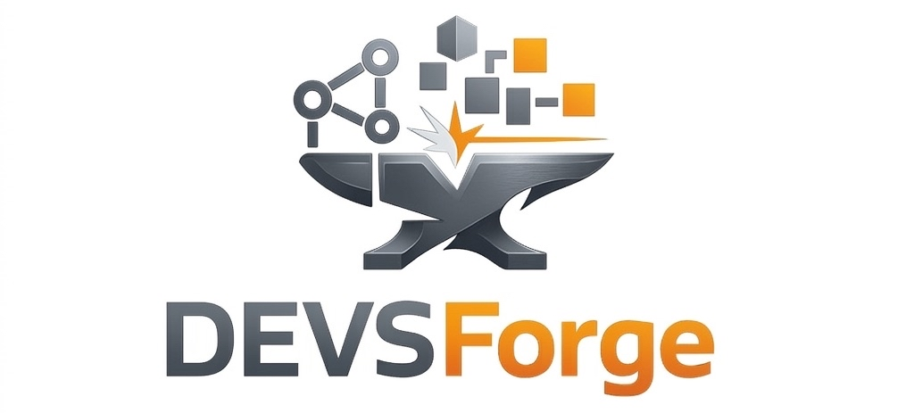

# DEVSForge



[](https://github.com/Doto-Apps/DEVSForge/actions/workflows/docker-ci.yml)
[](https://github.com/Doto-Apps/DEVSForge/actions/workflows/docker-publish.yml)
[](https://doi.org/10.5281/zenodo.19219365)
[](LICENSE)

DEVSForge is an AI-assisted modeling and simulation platform for DEVS systems.

## Architecture of DEVSForge

1. Frontend (React) calls backend REST APIs (typed from OpenAPI).
2. Backend (Go/Fiber) stores data in PostgreSQL.
3. Simulation orchestration uses Kafka and simulator components (coordinator + runners).
4. Wrappers (Go/Python) execute atomic-model behavior.

## Try it online

- Go to [DEVSForge website](https://devsforge.doto.ovh)

## Choose Your Install Mode

### Mode A: Run From GHCR Images (Recommended for self-hosting)

Use this mode to run DevForge quickly without local build.

Clone repository (to get compose and env templates):

```bash
git clone https://github.com/Doto-Apps/DEVSForge
cd DEVSForge
```

Prepare release env:

```bash
cp .env.dist .env
python3 scripts/ensure-lsp-env.py
```

Pull and run:

```bash
docker compose pull
docker compose up -d
```

Access:

- Frontend: `http://localhost`
- Backend: `http://localhost:3000`
- Swagger: `http://localhost:3000/swagger/index.html`

Stop:

```bash
docker compose down
```

### Mode B: Local Development Stack (Recommended for development)

Use this mode when actively developing frontend/backend.

Install `task` command: <https://taskfile.dev/docs/installation#install-script>

Local Go tools must use Go **1.26.2 or newer**, as required by `go.work` and the module files. Docker and CI already use Go 1.26.2.
If VS Code reports `go.work requires go >= 1.26.2` while the terminal works, select the matching SDK with **Go: Choose Go Environment**, then run **Go: Restart Language Server**. The editor may still be using an older Go installation despite the terminal's automatic toolchain selection.

Run `task setup` to install git hooks

Start backend and simulator (terminal 1, hot reload):

```bash
task back:dev
```

Start frontend (terminal 2, hot reload):

```bash
task front:dev
```

Access:

- Frontend: `http://localhost:5173`
- Backend: `http://localhost:3000`
- Swagger: `http://localhost:3000/swagger/index.html`

## Docker Images

- Frontend: `ghcr.io/doto-apps/devsforge-frontend`
- Backend: `ghcr.io/doto-apps/devsforge-backend`
- Simulator: `ghcr.io/doto-apps/devsforge-simulator`
- LSP: `ghcr.io/doto-apps/devsforge-lsp`

## Repository Navigation

| Module | Purpose | Documentation |
| --- | --- | --- |
| `back/` | API, persistence, AI generation, simulation orchestration | [back/README.md](back/README.md) |
| `front/` | UI for modeling, generation, validation, simulation, webapps | [front/README.md](front/README.md) |
| `simulator/` | DEVS distributed runtime (coordinator, runners, shared contracts) | [simulator/README.md](simulator/README.md) |
| `simulator/runner/integrations/` | Versioned integration resources, wrappers, AI templates and LSP | [docs/integrations.md](docs/integrations.md) |
| Reproducibility assets | Case-study protocols and experiment flow | [docs/reproducibility.md](docs/reproducibility.md) |

## Reproducibility

- Main guide: [docs/reproducibility.md](docs/reproducibility.md)

## Citation

Citation metadata is available in [`CITATION.cff`](CITATION.cff).

BibTeX:

```bibtex
@software{dominici_devsforge,
  author       = {Dominici, Antoine and Maliszewski, Dorian and Capocchi, Laurent},
  title        = {DEVSForge},
  year         = {2026},
  url          = {https://github.com/Doto-Apps/DEVSForge}
}
```

## License

MIT - see [LICENSE](LICENSE).

## Integrations and language assistance

See [the integration guide](docs/integrations.md) for the unified catalogue, Python/Go/Java LSP, environment limits and adding another integration. Existing `task back:dev` and `task front:dev` commands remain the development entrypoints.

Model editors now share persistent local tabs across libraries. Unsaved changes and generator conversations can be recovered after reload. Python, Go and Java reuse analysis workspaces within a browser window; the default LSP budget is 4 GiB with six active workspaces (at most two Java), and excess requests wait. See [workbench behavior, browser checks and measured startup/memory](docs/integrations.md#model-workbench-and-local-recovery).

Pour comprendre le fonctionnement pas à pas : [guide d’architecture en français — LSP, onglets, fichiers, simulation et IA](docs/architecture-lsp-et-editeur.md).

Pour ajouter le service à un VPS existant : [configuration LSP avec Docker Compose et Traefik](docs/lsp-vps.md).
