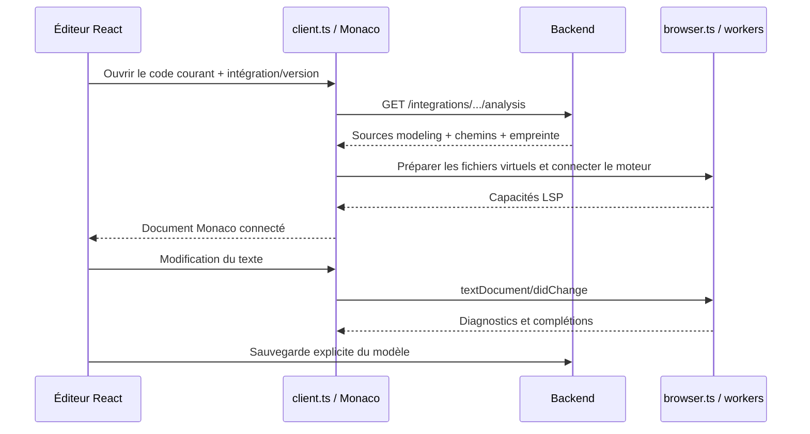

# Où sont les fichiers et qui fait quoi dans DEVSForge ?

Ce guide est le point d’entrée pour comprendre le code de l’éditeur, les intégrations et l’assistance de langage. Il décrit l’architecture actuelle : **Python, Go et Java sont analysés dans le navigateur ; les simulations s’exécutent dans le simulateur.**

Pour les versions des moteurs, leurs limites et les commandes de vérification, lire ensuite [le guide des moteurs navigateur](browser-lsp.md). Pour ajouter une intégration, lire [le guide du catalogue](integrations.md).

## 1. Les quatre choses à distinguer

| Ce dont on parle | Où cela se trouve | Quand cela change |
| --- | --- | --- |
| Les sources de la plateforme et des bibliothèques `modeling` | Dans ce dépôt Git. | Quand on développe DEVSForge. |
| Le modèle sauvegardé par un utilisateur | Dans PostgreSQL, via le backend. | Lors d’une sauvegarde explicite. |
| Le document ouvert et ses copies de récupération | Dans Monaco, le workbench et le stockage local du navigateur. | Pendant l’édition et lors des copies locales. |
| Le projet utilisé pour analyser ce document | Dans le système de fichiers virtuel des workers du navigateur. | À l’ouverture et pendant les échanges LSP. |

Un fichier `model.py` visible dans une URI LSP n’est donc pas un fichier sauvegardé dans le dépôt ou sur le VPS. Le modèle en base peut encore contenir l’ancienne version pendant que son document Monaco contient les changements non sauvegardés.

## 2. La carte du dépôt

```text
DEVSForge/
├── back/
│   ├── handler/language.go           # HTTP : catalogue, templates, sources d’analyse
│   ├── handler/model.go              # HTTP : modèles utilisateur
│   ├── router/router.go              # Enregistrement des groupes de routes
│   ├── database/integrations.go      # Projection du catalogue et contrôle des versions
│   ├── database/migrations/          # Évolution de la base
│   └── docs/                         # Swagger/OpenAPI générés
├── simulator/
│   ├── shared/integrations/
│   │   ├── catalog.go                # Lecture/validation des définitions communes
│   │   └── analysis.go               # Construction du paquet de sources pour le navigateur
│   ├── runner/
│   │   ├── integrations/
│   │   │   ├── registry.go           # Préparations de simulation compilées en Go
│   │   │   ├── xdevs-python/
│   │   │   ├── xdevs-go/
│   │   │   └── xdevs-java/
│   │   └── internal/prepare.go       # Copie du wrapper pour une simulation
│   ├── shared/proto/                # Bindings Go du protocole de simulation
│   └── proto/devs.proto             # Contrat gRPC commun aux wrappers
└── front/
    ├── src/components/custom/ModelCodeEditor.tsx # Vue React de l’éditeur
    ├── src/providers/WorkbenchProvider.tsx      # Onglets, brouillons, récupération
    ├── src/lib/lsp/                  # Connexions et moteurs dans le navigateur
    ├── language-tools/              # Recettes de construction, patches et licences
    └── public/language-tools/       # Résultats générés, ignorés par Git
```

Le nom `lsp` du dossier frontend reste pertinent : LSP est le protocole entre l’éditeur et les moteurs, même quand les deux sont sur le même ordinateur.

## 3. Où modifier les vraies bibliothèques de modélisation ?

Elles restent dans les intégrations, avec les fichiers utilisés pour l’exécution :

| Langage | Sources à modifier |
| --- | --- |
| Python | [`wrapper/modeling/modeling.py`](../simulator/runner/integrations/xdevs-python/wrapper/modeling/modeling.py), exportées par son `__init__.py`. |
| Go | [`wrapper/modeling/`](../simulator/runner/integrations/xdevs-go/wrapper/modeling/) : `atomic.go`, `component.go`, `port.go`, etc. |
| Java | [`wrapper/src/main/java/com/devsforge/runner/modeling/`](../simulator/runner/integrations/xdevs-java/wrapper/src/main/java/com/devsforge/runner/modeling/) : `Atomic.java`, `Component.java`, `Port.java`, etc. |

**Il n’existe pas une deuxième implémentation de `modeling` à maintenir dans le frontend.** Le backend lit ces sources et les transmet au navigateur. Le simulateur reçoit sa propre copie des mêmes ressources dans son image. Les conteneurs ne supposent pas un disque partagé en production.

Une intégration ressemble à ceci :

```text
simulator/runner/integrations/xdevs-python/
├── integration.json       # Identité et chemins des ressources
├── prepare.go             # Préparation et lancement pour la simulation
├── wrapper/               # Bibliothèque réelle, serveur RPC, dépendances
│   ├── modeling/
│   └── ...
├── templates/atomic.tmpl  # Code initial à la création d’un modèle
├── ai/model.md            # Instructions spécifiques à la génération IA
├── generate-proto.sh      # Génération gRPC de ce langage
└── README.md
```

[`integration.json`](../simulator/runner/integrations/xdevs-python/integration.json) indique notamment :

| Champ | Ce qu’il décide |
| --- | --- |
| `id`, `version` | L’identité du framework/langage et de ses ressources. |
| `language` | Le langage de l’éditeur et le moteur navigateur à sélectionner. |
| `preparation` | L’entrée du registre Go utilisée pour lancer une simulation. |
| `wrapper` | Le dossier réel à copier pour exécuter un modèle. |
| `modelPath` | Le chemin technique du fichier utilisateur dans le projet. |
| `template` | Le fichier de code initial. |
| `prompt` | Les instructions IA propres à cette intégration. |
| `context` | Les vraies sources de bibliothèque envoyées à l’IA et à l’analyse locale. |

Le chargeur [`catalog.go`](../simulator/shared/integrations/catalog.go) valide ces chemins, calcule une empreinte et déduit les capacités. `capabilities.lsp` indique la présence des ressources d’analyse (`wrapper` et `context`) ; la prise en charge effective d’un langage par un moteur reste dans le frontend. Il n’y a plus de champ `servers`, de commande native ou de chemin JDT LS dans les définitions.

## 4. Quel fichier du backend gère quelle partie ?

Les handlers reçoivent les requêtes HTTP. Le module partagé collecte les fichiers ; il ne connaît ni Fiber ni Monaco.

| Fichier | Responsabilité actuelle |
| --- | --- |
| [`back/router/router.go`](../back/router/router.go) | Appelle `SetupLanguageRoutes` pour enregistrer les routes de catalogue. |
| [`back/handler/language.go`](../back/handler/language.go) | Répond aux demandes de catalogue, template et sources d’analyse. Gère les codes HTTP et le cache ETag. |
| [`simulator/shared/integrations/catalog.go`](../simulator/shared/integrations/catalog.go) | Trouve `INTEGRATIONS_DIR`, lit les JSON, résout une intégration et ses ressources, produit templates et contexte IA. |
| [`simulator/shared/integrations/analysis.go`](../simulator/shared/integrations/analysis.go) | Construit `AnalysisSources` à partir de `context`, avec des chemins relatifs au wrapper. Lit aussi le nom du module Go. |
| [`back/database/integrations.go`](../back/database/integrations.go) | Synchronise la projection du catalogue en base et refuse les ressources incompatibles sous une version déjà enregistrée. |
| [`back/handler/model.go`](../back/handler/model.go) | Conserve le parcours normal de lecture et sauvegarde des modèles utilisateur. |
| [`back/docs/`](../back/docs/) et [`front/src/api/v1.d.ts`](../front/src/api/v1.d.ts) | Décrivent le contrat HTTP généré, sans implémenter l’analyse. |

### Les routes utiles

| Route GET | Ce qu’elle renvoie |
| --- | --- |
| `/integrations` | Identités, versions, langages, chemins et capacités du catalogue. |
| `/integrations/{id}/versions/{version}/template?name=Example` | Le code initial rendu avec le nom demandé. |
| `/integrations/{id}/versions/{version}/analysis` | Le paquet de sources nécessaire au projet d’analyse. |
| `/languages` et `/languages/{lang}/template` | Les adaptateurs conservés pour les anciens clients de l’API. |

Le paquet d’analyse contient `integrationId`, `integrationVersion`, `language`, `modelPath`, `digest`, `files` et le nom du module pour Go. `files` est une correspondance **chemin relatif → texte du fichier**. Il ne contient pas les modèles privés d’un utilisateur ni les prompts IA.

Exemple simplifié pour Python :

```json
{
  "integrationId": "xdevs-python",
  "integrationVersion": "1.0.0",
  "language": "python",
  "modelPath": "model.py",
  "digest": "...",
  "files": {
    "modeling/__init__.py": "...",
    "modeling/modeling.py": "..."
  }
}
```

Le collecteur contrôle les chemins, y compris les liens symboliques, ignore les caches et les données binaires, et borne les tailles : 2 Mio par fichier, 8 Mio au total. Le handler utilise l’empreinte comme ETag ; une requête portant l’empreinte courante peut recevoir `304`.

La route est publique parce qu’elle expose uniquement les bibliothèques livrées avec la plateforme. Les routes de modèles et de sauvegarde conservent leur authentification. Le code actuellement saisi arrive au moteur local depuis Monaco, sans requête de création de session sur le backend.

## 5. Les fichiers frontend : chacun a un rôle

| Fichier | Ce qu’il règle |
| --- | --- |
| [`ModelCodeEditor.tsx`](../front/src/components/custom/ModelCodeEditor.tsx) | Crée la vue React/Monaco, affiche l’état de l’aide, conserve la position de lecture et revient au document après une navigation vers une source. |
| [`client.ts`](../front/src/lib/lsp/client.ts) | Initialise Monaco et `monaco-languageclient`, conserve les documents, branche les fonctionnalités LSP, limite les modifications aux fichiers utilisateur et présente les bibliothèques en lecture seule. |
| [`browser.ts`](../front/src/lib/lsp/browser.ts) | Construit les projets virtuels, choisit les moteurs et partage leurs instances dans un espace de travail. Gère aussi les messages de contrôle : fichiers, lecture, création et fermeture. |
| [`go.worker.ts`](../front/src/lib/lsp/go.worker.ts) | Monte le système de fichiers de Go, charge le SDK et gopls WebAssembly, puis adapte son transport au client. |
| [`ruff.worker.ts`](../front/src/lib/lsp/ruff.worker.ts) | Adapte l’API WebAssembly de Ruff aux demandes de diagnostics, corrections et formatage. |
| [`java.worker.ts`](../front/src/lib/lsp/java.worker.ts) | Charge B-JVM et les JAR, prépare les fichiers en mémoire et relie chaque Javacs à son canal. |
| [`framing.ts`](../front/src/lib/lsp/framing.ts) | Encode/décode les trames LSP de Go et Java : en-tête `Content-Length`, octets UTF-8 et messages partiels. |

Pyright Browser est un worker fourni par la dépendance `@typefox/pyright-browser`. C’est pourquoi il n’y a pas de fichier local `pyright.worker.ts`. `browser.ts` le démarre et lui transmet ses fichiers et paramètres.

Il y a deux échanges différents avec les workers : les messages de contrôle préparent les fichiers ; les messages LSP demandent des complétions, diagnostics, définitions, etc. Un `MessagePort` reste local au navigateur : ce n’est pas une connexion WebSocket au VPS.

## 6. À quoi ressemblent les fichiers virtuels ?

Python partage les sources `modeling` dans `sdk/` et sépare ses documents :

```text
/workspaces/devsforge-<espace-python>/
├── sdk/modeling/
│   ├── __init__.py
│   └── modeling.py
└── projects/<document>/
    ├── model.py
    └── pyrightconfig.json
```

`pyrightconfig.json` indique le chemin vers `sdk/` et `/typeshed/`, qui contient les types de la bibliothèque standard Python.

Go utilise un module distinct par document et une bibliothèque locale partagée :

```text
/workspaces/devsforge-<espace-go>/
├── sdk/
│   ├── go.mod
│   └── modeling/
│       ├── atomic.go
│       └── ...
└── projects/<document>/
    ├── model.go
    └── go.mod
```

Le `go.mod` du document contient un nom de module unique et un `replace` vers `sdk/`. Les sources standard sont montées sous `/goroot/src/` ; `/gopath/pkg/mod/` sert aux ressources de paquets du moteur. Ces chemins sont virtuels, propres au worker.

Java utilise un projet par document, contenant sa propre copie des sources `modeling` :

```text
/workspaces/devsforge-<espace>/projects/<document>/
└── src/main/java/com/devsforge/runner/
    ├── Example.java           # Nom déduit du type public dans le code
    └── modeling/
        ├── Atomic.java
        ├── Component.java
        └── ...
```

Les classes standard OpenJDK et les JAR de Javacs sont chargés séparément dans le système virtuel de B-JVM. Un chargeur de classes Javacs distinct par projet évite de mélanger deux modèles contenant chacun une classe `Example`.

Le nom affiché d’un modèle, par exemple `light ` avec son espace final, ne sert pas de chemin. Python utilise `model.py`, Go `model.go` et Java le type public déclaré dans le code. Un nom d’onglet n’est pas un nom de fichier système.

Ces projets sont reconstruits à partir des ressources et du brouillon courant. Ils ne sont pas des copies durables de sauvegarde. Ajouter des fichiers arbitraires à un modèle n’est pas encore une fonctionnalité utilisateur : le modèle atomique conserve actuellement un champ de code principal.

## 7. Ouverture, frappe, changement d’onglet et sauvegarde



La clé de partage est **compte + fenêtre de travail + intégration + version**. Le compte et l’identité de fenêtre sont inclus dans le `workbenchId`, puis `client.ts` lui ajoute l’intégration et sa version.

Changer d’onglet détache la vue sans fermer le document Monaco ni le moteur. Cela conserve l’annulation, la position de lecture et les index. Fermer réellement un onglet retire son document. Java ferme son Javacs privé ; la JVM reste partagée tant que d’autres documents Java sont présents. Le dernier document Java fermé ou la fermeture de l’espace termine son worker et libère toute la VM.

Un rechargement restaure les brouillons locaux et reconstruit l’analyse. Les échanges de texte LSP utilisent des positions UTF-16 ; les trames Go/Java utilisent des octets UTF-8. Le pont Java transporte ces octets en base64 pour préserver les accents et emojis.

## 8. Où sont gérés les onglets et les brouillons ?

| Fichier | Responsabilité |
| --- | --- |
| [`WorkbenchProvider.tsx`](../front/src/providers/WorkbenchProvider.tsx) | État partagé au-dessus des pages : onglets, modèles modifiés et brouillons de générateurs. Copie de récupération locale et séparation par compte/fenêtre. |
| [`model-tabs.tsx`](../front/src/components/nav/model-tabs.tsx) | Affichage des onglets, activation, fermeture et réorganisation. |
| [`nav-header.tsx`](../front/src/components/nav/nav-header.tsx) | Chemin et actions de l’onglet actif : sauvegarder, simuler, valider. |
| [`EditModel.tsx`](../front/src/pages/model/EditModel.tsx) | Assemble la page d’un modèle et son code ou diagramme. |

| Stockage | Contenu |
| --- | --- |
| Mémoire Monaco/workbench | Texte courant, état d’interface, annulation pendant la navigation. |
| IndexedDB, base `devsforge-workbench` | Copies de récupération des onglets, diagrammes, brouillons et conversations. |
| `sessionStorage` | Pointeur de récupération de la fenêtre et copie de secours. |
| PostgreSQL | Modèles effectivement sauvegardés par l’API. |
| Mémoire des workers | Fichiers virtuels et index d’analyse, reconstruits à la demande. |

Un changement d’onglet ne sauvegarde rien sur le serveur. Fermer un onglet modifié propose Enregistrer / Abandonner / Annuler. La sauvegarde locale IndexedDB n’est pas une sauvegarde distante ; l’historique d’annulation n’est pas sérialisé après rechargement.

## 9. Pourquoi `front/language-tools/` et `front/public/language-tools/` ?

Le premier contient **les recettes**, le second **leurs résultats générés** :

| Source versionnée | Résultat ou rôle |
| --- | --- |
| [`front/Dockerfile`](../front/Dockerfile) | Construit les outils, les rassemble puis construit le frontend. |
| [`build-python.py`](../front/language-tools/build-python.py) | Prépare les fichiers de types standard correspondant à Pyright Browser. |
| [`build-go.py`](../front/language-tools/build-go.py) | Construit gopls WebAssembly et son chargeur de paquets, puis exporte les sources du SDK Go. |
| [`java/build-runtime.sh`](../front/language-tools/java/build-runtime.sh) | Prépare les classes et modules OpenJDK utilisés par l’analyse. |
| [`java/BrowserBridge.java`](../front/language-tools/java/BrowserBridge.java) | Transport LSP et isolation des projets dans la JVM ; n’implémente pas les complétions. |
| [`java/browser.patch`](../front/language-tools/java/browser.patch) | Adaptations de Javacs à la JVM navigateur. |
| [`java/bjvm.patch`](../front/language-tools/java/bjvm.patch) | Correctifs de compatibilité B-JVM nécessaires à Javacs. |
| [`check-assets.mjs`](../front/language-tools/check-assets.mjs) | Vérifie que les résultats indispensables existent avant le build frontend. |
| [`NOTICE.md`](../front/language-tools/NOTICE.md) | Références et licences des dépendances distribuées. |
| [`smoke.html`](../front/language-tools/smoke.html) | Point d’entrée du test navigateur, sans compte ni base utilisateur. |

Il ne faut pas éditer les fichiers de `front/public/language-tools/` à la main : une reconstruction les remplace. Ils ne contiennent pas les bibliothèques `modeling` de l’application. Ces dernières viennent du backend à l’ouverture d’une intégration.

Les versions sont fixées dans le Dockerfile et les scripts. L’image frontend sert les outils depuis sa propre origine, sans CDN Java externe. [Le README Java](../front/language-tools/java/README.md) détaille les adaptations de B-JVM.

## 10. Ce qui a été retiré du LSP serveur

Le backend ne crée plus de session, de ticket à usage unique, de relais WebSocket ou de fichier temporaire d’analyse. Le runner n’a plus de mode daemon d’assistance.

Ont été retirés : `back/handler/lsp.go`, `simulator/runner/internal/lsp/`, les anciens `analysis.go` des trois préparations de simulation, le script d’environnement du service, le conteneur LSP, ses variables et ses commandes de lancement. Les déclarations natives `servers` ont aussi été supprimées du catalogue et du contrat API généré. Dans le frontend, les callbacks vides `touch` et `disposeDocument` ainsi que les abonnements clavier/souris de maintien de session ont été retirés : les onglets pilotent désormais la durée de vie locale des documents.

Deux fichiers portant le nom `analysis.go` ne doivent pas être confondus : les adaptations de l’ancien daemon ont disparu ; [`simulator/shared/integrations/analysis.go`](../simulator/shared/integrations/analysis.go) reste utile parce qu’il collecte les sources pour l’API.

La migration [`000012_browser_catalog_metadata`](../back/database/migrations/000012_browser_catalog_metadata.up.sql) convertit les empreintes connues des trois intégrations `1.0.0` après ce retrait de métadonnées. Elle ne change ni code utilisateur ni référence d’intégration. Les empreintes inconnues restent soumises au contrôle de version habituel. Les migrations historiques ne sont pas réécrites.

## 11. La simulation et l’IA utilisent les mêmes ressources autrement

La simulation a son propre parcours :

```text
Modèle sauvegardé → Backend → Coordinateur → Kafka → Runner
                                                      │
                                                      └─ gRPC → Wrapper → Modèle
```

[`internal/prepare.go`](../simulator/runner/internal/prepare.go) copie le wrapper dans le répertoire temporaire du modèle de simulation. Le registre [`registry.go`](../simulator/runner/integrations/registry.go) ne contient plus qu’une opération `Launch`. La préparation propre au langage appelle `PrepareSources`, puis compile si nécessaire et lance le wrapper. Ces préparations ne sont pas exécutées pour ouvrir l’éditeur.

Pour Java, `source_name.go` détermine le nom depuis la déclaration publique lors de la préparation de simulation. Le frontend effectue sa propre détermination du chemin pour son projet virtuel, sans importer le module Go du runner.

Le contrat gRPC reste dans [`simulator/proto/devs.proto`](../simulator/proto/devs.proto), les bindings Go communs dans [`simulator/shared/proto/`](../simulator/shared/proto/). Les serveurs RPC spécifiques restent dans les wrappers. Les fichiers temporaires de simulation sur disque sont distincts des fichiers d’analyse en mémoire du navigateur.

L’IA utilise le `template`, le `prompt` et les fichiers de `context`, assemblés par `catalog.go` avec une limite de 180 Ko. Le LSP n’appelle pas l’IA. Les diagrammes et les propositions de structure relèvent de [`llmToReactFlow.ts`](../front/src/lib/llmToReactFlow.ts) (construction et validation de la hiérarchie), [`StructureEditor.tsx`](../front/src/components/custom/generate/StructureEditor.tsx) et [`StructureConversation.tsx`](../front/src/components/custom/generate/StructureConversation.tsx).

## 12. Je veux changer quelque chose : où aller ?

| Changement souhaité | Point de départ |
| --- | --- |
| Ajouter une méthode à `Atomic` | La vraie bibliothèque `modeling` de l’intégration concernée. |
| Choisir quelles sources de bibliothèque sont exposées | `integration.json` → `context`, puis `shared/integrations/analysis.go`. |
| Modifier le code initial d’un modèle | `templates/atomic.tmpl`. |
| Modifier les instructions de génération IA | `ai/model.md` et `catalog.go` pour l’assemblage. |
| Modifier la réponse HTTP ou le cache des sources | `back/handler/language.go`. |
| Modifier les chemins virtuels, imports locaux ou modules Go d’analyse | `front/src/lib/lsp/browser.ts`. |
| Modifier les fonctionnalités Monaco ou les protections des éditions | `front/src/lib/lsp/client.ts`. |
| Modifier un moteur ou ses options de transport | Le worker concerné, puis les scripts de build si nécessaire. |
| Modifier la récupération d’un brouillon | `WorkbenchProvider.tsx`. |
| Modifier l’apparence des onglets ou du header | `model-tabs.tsx` / `nav-header.tsx`. |
| Modifier la compilation ou l’exécution d’un modèle | `prepare.go` de l’intégration et `registry.go`. |
| Ajouter un langage ou un autre framework | [Le parcours des intégrations](integrations.md#adding-another-integration-later). |

Après une modification de bibliothèque, reconstruire les images backend et simulateur avec les mêmes ressources. En production, une modification incompatible impose une nouvelle version ; en développement, `INTEGRATIONS_ALLOW_CHANGES=true` permet les essais prévus par le Compose. Une session d’éditeur déjà ouverte garde son paquet de sources : rouvrir l’espace ou recharger pour récupérer les nouvelles ressources.
