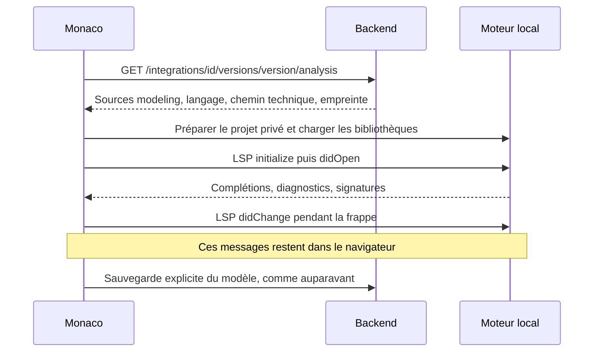

# L’assistance de code dans le navigateur

Python, Go et Java sont analysés sur l’ordinateur de l’utilisateur. Le VPS ne lance plus de serveur de langage, ne reçoit plus les frappes et ne prépare plus de session LSP. **La simulation continue à s’exécuter dans le simulateur.**

## Les moteurs utilisés

| Langage | Analyse | Où tourne le moteur ? |
| --- | --- | --- |
| Python | Pyright Browser 1.1.299 | Worker JavaScript, avec son worker d’analyse |
| Python | Ruff 0.17.4 | WebAssembly dans un worker ; diagnostics, corrections et formatage |
| Go | Port navigateur de gopls + chargeur de paquets | WebAssembly dans un worker, avec le véritable SDK Go 1.26.2 sous forme de sources |
| Java | Javacs, basé sur le compilateur Java | B-JVM (MIT), WebAssembly dans un worker ; OpenJDK 23 |

Python n’a pas besoin d’être compilé en WebAssembly pour fonctionner localement : Pyright est écrit en TypeScript. Aucun de ces moteurs n’exécute les modèles. Les processeurs d’annotations Java sont désactivés par Javacs.

Javacs fournit la complétion, les diagnostics, les signatures, la navigation, les références, le renommage et des corrections Java. Son action de formatage organise les imports et ajoute des annotations `@Override` ; elle ne constitue pas un formateur complet du code.

## Ce qui se passe à l’ouverture



La nouvelle route fournit uniquement les sources de modélisation déclarées par le catalogue. Elle ne fournit ni prompts IA, ni secrets, ni fichiers d’autres utilisateurs. Elle accepte les validateurs HTTP `ETag`. Chaque fichier est limité à 2 Mio et l’ensemble à 8 Mio ; les chemins sortant de l’intégration sont refusés, y compris par lien symbolique.

Les fichiers réels restent dans `simulator/runner/integrations/`. Le frontend ne possède aucune liste copiée des méthodes d’`Atomic`. Modifier une bibliothèque et publier une nouvelle version fournit donc également les nouvelles méthodes à l’analyse.

Les bibliothèques standard sont des ressources statiques construites avec l’image frontend : typeshed pour Python, sources du SDK pour Go, classes OpenJDK construites avec l’image pour Java.

## Partage entre modèles et isolation

Une fenêtre conserve un espace par **compte, fenêtre, intégration et version**. Changer d’onglet ne relance pas le moteur. Les modèles Monaco gardent leur URI, leurs modifications et leur historique d’annulation tant que l’onglet reste ouvert.

Python et Go partagent leurs moteurs entre documents. Chaque modèle possède cependant son répertoire technique ; deux classes ou fonctions portant le même nom restent séparées.

Java partage une seule JVM dans la fenêtre, avec un serveur Javacs et un chargeur de classes isolés par projet. C’est nécessaire car Javacs utilise des index statiques et ne gère pas plusieurs projets homonymes dans un même index. Les classes du JDK et le runtime sont partagés ; les index des modèles ne le sont pas.

Fermer un onglet retire son document. Fermer l’espace ou changer de compte libère les moteurs, les ports et les modèles. Les processus reçoivent d’abord la demande d’arrêt LSP avant la fermeture du transport. Une panne de l’assistance conserve les documents Monaco pour que l’édition reste possible.

Les réponses LSP n’autorisent des modifications que sur les documents utilisateur ouverts. La navigation vers les bibliothèques crée des vues en lecture seule. Les changements de texte passent par le client LSP en UTF-16 ; les transports natifs Go et Java utilisent des trames UTF-8 avec une longueur calculée en octets.

Le système de fichiers Java reste en mémoire dans le worker, sans IndexedDB, iframe ou verrou interfenêtres. La fermeture du dernier document Java libère sa JVM ; une nouvelle ouverture la reconstruit. Les brouillons restent gérés séparément par le workbench.

Les messages contenant le code sont transmis en UTF-8/base64 au pont Java : cela évite la conversion de chaînes « modified UTF-8 » de B-JVM, notamment pour les accents et emojis.

Le nom affiché ne sert pas de chemin : `light ` reste un nom valide pour un modèle existant. Python utilise `model.py`, Go `model.go` et Java le nom du type public déclaré dans le code, y compris les identifiants Unicode usuels.

## Comprendre les fichiers

La [carte de l’architecture](architecture-lsp-et-editeur.md) décrit chaque dossier, les changements du backend, les handlers, les fichiers virtuels et le stockage des brouillons. Le [README Java](../front/language-tools/java/README.md) détaille les correctifs des moteurs. Les configurations d’exécution du simulateur restent indépendantes de celles des workers.

## Développement et tests

Les commandes habituelles restent :

```sh
task back:dev
task front:dev
```

`front:dev` construit les outils statiques s’ils manquent ou si leurs sources changent. Cette préparation utilise Docker ; aucun serveur LSP ne reste actif sur l’hôte. Pour la relancer explicitement :

```sh
task front:language-tools
```

Les gros fichiers générés vont dans `front/public/language-tools/` et sont ignorés par Git. Les versions et révisions sources sont fixées dans le Dockerfile et les scripts de construction.

Pour vérifier les moteurs dans Chromium, sans base de données ni appel IA :

```sh
cd front
pnpm exec playwright install chromium
cd ..
task front:lsp:test
```

Le script démarre son propre Vite et utilise les vraies bibliothèques du dépôt. Il vérifie notamment `self.get_phase`, `math.sqrt`, `Atomic.GetPhase`, `math.Sqrt`, `Atomic.getPhase`, `Math.sqrt`, les noms identiques, l’espace final de `light `, les positions UTF-16, les diagnostics, la navigation vers les sources, la fermeture et la réouverture. Il vérifie également que les échanges d’analyse restent locaux au navigateur.

Les signatures, le renommage et la réponse du formatage sont également vérifiés. Les essais séparent deux comptes/fenêtres et injectent une panne du worker Python pour vérifier que le texte reste modifiable et que la reconnexion le conserve.

`task front:workbench:test` vérifie aussi l’éditeur React avec une véritable API et une base de test isolée : récupération des brouillons Python, complétion Go et Java, réutilisation du moteur entre deux onglets du même langage et sauvegarde du bon document, même immédiatement après une modification. Les deux URL et la préparation de cette pile sont décrites dans [le guide des intégrations](integrations.md#workbench-regression-checks).

## Coût et limites de cette branche

Le coût des moteurs passe dans le navigateur. Le VPS sert leurs fichiers statiques et les sources des intégrations ; il ne réserve plus plusieurs gigaoctets pour les sessions d’édition. Le cache disque du serveur web reste récupérable par le système.

Les ressources Java incluent le moteur WebAssembly, Javacs et les classes d’OpenJDK ; tout est servi par le frontend, sans CDN Java externe. Le chargement reste différé jusqu’à l’ouverture du langage concerné et bénéficie du cache HTTP. Les espaces et index restent locaux. La JVM dispose initialement d’un tas de 256 Mio par espace ; le worker et les structures natives consomment de la mémoire en plus.

Mesures locales du 12 novembre 2026 dans Chrome sur le Mac de développement, jusqu’à la première complétion utile : environ **1,5 s Python, 7,6 s Go et 18 s Java**. Java représente environ 70 Mio d’outils statiques avant compression HTTP. Ces mesures ne donnent ni un plafond de RAM ni les performances d’un ordinateur peu puissant. Le test affiche ce délai ; qualifier séparément les démarrages à froid et à chaud sur les machines visées.

Limites explicites :

- Le port Pyright publié par TypeFox est ancien et archivé. Il couvre les modèles actuels, mais ne garantit pas les nouveautés des dernières versions de Python et de son système de types. Son adaptateur est séparé pour pouvoir remplacer ce moteur.
- Le port gopls est expérimental. Les commandes qui exigent un outil natif — tests, installation de modules, compilation — ne sont pas proposées comme actions exécutables.
- B-JVM est expérimental et ne couvre pas toutes les API natives du JDK. Le runtime embarqué contient `java.base`, `java.compiler`, `jdk.compiler`, `jdk.zipfs`, `java.logging`, `java.xml` et `jdk.unsupported`, sans JavaFX ni Swing. Les modèles continuent à être exécutés avec Java 21 dans le simulateur. L’analyse doit donc être confrontée à la compilation réelle avant de dépendre d’API récentes du JDK.
- La navigation vers les sources de `modeling` fonctionne ; cette version ne fournit pas l’archive des sources du JDK au navigateur.
- Renommer le type public Java peut demander de fermer puis rouvrir l’onglet pour actualiser son nom de fichier technique ; les opérations de création ou renommage de fichiers ne sont pas appliquées automatiquement.
- Il n’y a pas d’installation automatique de paquets pip, Go ou Maven. Une bibliothèque absente doit encore être ajoutée aux ressources d’analyse. Il n’y a pas de repli caché vers le serveur.
- Les tests automatisés actuels utilisent Chromium. Safari, Firefox et les machines peu puissantes restent à qualifier.

## Déploiement sur un VPS existant

Le contexte de construction de `front/Dockerfile` devient la racine du dépôt. L’image frontend contient les ressources statiques ; l’image backend expose la nouvelle route. Publier ces deux images ensemble. Le backend applique les migrations au démarrage avant de synchroniser le catalogue. La migration `000012_browser_catalog_metadata` adapte uniquement les empreintes connues après la suppression des anciennes déclarations de lancement ; elle ne modifie pas les modèles. Conserver une sauvegarde de la base avant la mise à jour et publier les ressources backend/simulateur correspondantes ensemble.

Retirer le service `lsp` de votre Compose personnalisé et les variables `LSP_*` devenues inutiles. Ne pas remplacer les volumes de base de données de votre configuration par ceux des exemples du dépôt. Si l’ancien conteneur tourne encore, l’arrêter depuis l’ancien Compose avant de retirer sa définition :

```sh
docker compose stop lsp
docker compose rm -f lsp
```

Les outils manquants doivent renvoyer 404, et non `index.html`. Le chargement Java est entièrement local, depuis `/language-tools/java/`. Une CSP doit autoriser les workers locaux et l’exécution WebAssembly. Le runtime télécharge les octets décodés sans dépendre de `Content-Length`, afin de fonctionner avec la compression HTTP.

## Dépendances et licences

Les adaptateurs appartiennent au projet ; les moteurs restent des dépendances externes. Les avis sont regroupés dans `front/language-tools/NOTICE.md`. B-JVM et Javacs utilisent une licence MIT, mais OpenJDK conserve sa licence GPL avec exception Classpath et ses notices. Tous les fichiers Java sont servis par le frontend.

Sources : [Pyright Browser](https://github.com/TypeFox/pyright/tree/browser), [Ruff WebAssembly](https://github.com/astral-sh/ruff/tree/main/crates/ruff_wasm), [port gopls](https://github.com/Better-Go-Playground/tools/tree/gopls-wasm-support), [chargeur Go](https://github.com/Better-Go-Playground/go-packages-driver-wasm), [Javacs](https://github.com/georgewfraser/java-language-server), [B-JVM](https://github.com/anematode/b-jvm).
